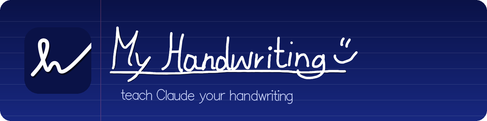
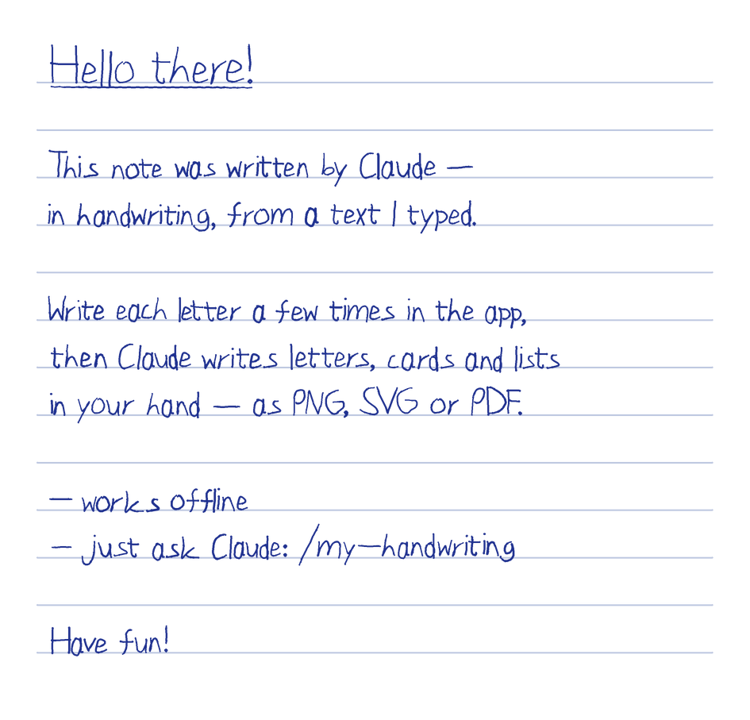
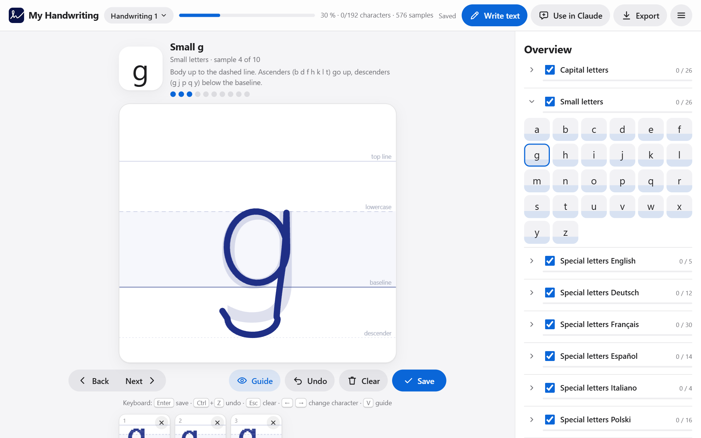

<p align="center">
  
</p>

<p align="center">
  <a href="https://github.com/HobbyPlayerDev/my-handwriting/actions/workflows/tests.yml"></a>
  <a href="LICENSE"></a>
  
  
  
</p>

<p align="center">
  Hi out there! I created this project because I wanted Claude to write in my handwriting without using
  an external website, and to have a simple solution. So I built this app with Claude: write every letter
  a few times and Claude writes letters, notes and cards in your handwriting ✍️
</p>

<h3 align="center">
  <a href="https://hobbyplayerdev.github.io/my-handwriting/">▶ Open the app</a> ·
  <a href="#-installation">Installation</a> ·
  <a href="#-use-in-claude">Use in Claude</a> ·
  <a href="https://github.com/HobbyPlayerDev/my-handwriting/issues/new/choose">Report a bug</a>
</h3>

## 🚀 Installation

The app is a web page so no account is needed. Pick one way:

| Way | How | Offline | Installable |
|---|---|:---:|:---:|
| 🌐 **Online** (recommended) | Open **<https://hobbyplayerdev.github.io/my-handwriting/>** | ❌ | ✅ |
| 📱 **As an app** | Open the address, then install it (steps below) | ✅ | – |
| 💾 **Download** (computer only) | *Code → Download ZIP* (or a [release](https://github.com/HobbyPlayerDev/my-handwriting/releases)), unzip, double-click `index.html` | ✅ | ❌ |

<details>
<summary><b>📱 Install as an app (iPhone, iPad, Android, computer)</b></summary>

Installed, it opens like an app, works offline and the browser keeps your data. In the app,
**☰ → Install as app** shows the steps for the device you are on.

| Device | How |
|---|---|
| **iPhone, iPad** | Open the address in **Safari** → Share button (square with arrow) → **Add to Home Screen** → Add. |
| **Android** | Open it in **Chrome** → menu ⋮ → **Install app** (or *Add to Home screen*). |
| **Windows, Mac, Linux** | **Chrome or Edge:** install icon at the right of the address bar. **Safari on Mac:** File → Add to Dock. **Firefox:** keep it as a bookmark. |

Phones cannot open an unzipped `index.html` well – use the address instead.
</details>

Then add the skill to Claude – see [Use in Claude](#-use-in-claude).

**Requirements:** a Claude account with code execution on (the free plan works too) and a browser from
about 2020 or newer (Chrome/Edge 80+, Firefox 78+, Safari 14+).

## ✍️ Output

<p align="center">
  
</p>

<p align="center">
  
</p>

## 🏁 How it works

1. **Write.** Open the app. A short setup asks for your language, your name and how your documents
   should look. Then write each character on the area and press **Save** (or <kbd>Enter</kbd>).
   3 samples per character take about 15 minutes, 10 about an hour.
2. **Give it to Claude.** **Use in Claude → Download ZIP**, then upload the ZIP in Claude under
   **Customize → Skills** (details [below](#-use-in-claude)).
3. **Ask Claude.** *"Write a thank-you note to my aunt in my handwriting as a PDF."* – done.

No Claude at hand? **Write text** in the app turns any text into PNG, SVG or PDF by itself, offline.

### 💾 Backup and keys

**Export** saves your handwriting as a file (`my-handwriting-glyphs-DATE.json`).
**Import** brings it back, also on another device. The app reminds you.

| Key | Action |
|---|---|
| <kbd>Enter</kbd> | save sample |
| <kbd>Ctrl</kbd>/<kbd>⌘</kbd> + <kbd>Z</kbd> | undo |
| <kbd>Esc</kbd> | clear the area |
| <kbd>←</kbd> <kbd>→</kbd> | previous / next character |
| <kbd>V</kbd> | guide letter on/off |
| <kbd>Ctrl</kbd> + mouse wheel | writing area bigger / smaller |

## 🤖 Use in Claude

Claude can write whole documents in your handwriting with the skill **`/my-handwriting`**.

1. In the app: **Use in Claude → Download ZIP** (the skill + your handwriting). **Don't unzip it.**
2. In Claude ([claude.ai](https://claude.ai/customize/skills)): **Customize → Skills → + → Upload a skill**
   → choose the ZIP. *Code execution* must be on (Settings → Capabilities).
3. In any chat: *"Write a thank-you note to my aunt in my handwriting as a PDF."* – or type
   `/my-handwriting` and what you want.

Claude first lists the settings it uses – the same as in the app – then answers as usual, in the
language you chose in the app:

> Settings: Size: 6 mm · Paper: Lined · Format: A4 · Colour: Blue · Alignment: Left ·
> Irregularity: 50 % · Make it look real: on · Fill in missing characters: on

The defaults come from **Settings → Documents** in the app. Ask for anything else in the chat
("bigger", "neater", "in red", "centred", "on squared paper") and Claude changes just that.

- 📱 **On the phone:** the ZIP is uploaded to your Claude account, not installed on the phone. Open
  [claude.ai](https://claude.ai/customize/skills) in the phone's browser (or use a computer), upload the
  ZIP as it is – the skill is then in the Claude apps on iPhone and Android too.
- 🔄 **New samples later?** Download the ZIP again, delete the old skill in Claude, upload the new one.
- ⚠️ **The ZIP contains your handwriting** – only upload it to your own account.

<details>
<summary><b>💻 Command line / Claude Code without upload</b></summary>

Python 3.8+ (standard library; PNG output needs `pip install pillow`). In the project folder:

```bash
S=skill/my-handwriting/scripts/my_handwriting.py
python $S install --glyphs ~/Downloads/my-handwriting-glyphs-2026-11-20.json   # -> ~/.claude/skills/my-handwriting/
python $S package --glyphs <file>             # my-handwriting-skill.zip, like the app's button
python $S info                                # which file, defaults, missing characters
python $S render --text "Hello world!" --out hello.pdf
python $S render --input letter.md --markdown --paper lined --out letter.pdf
python $S render --text "Hi" --irregularity 20 --align center --color red --out hi.png
python $S sheet --out overview.pdf            # all your samples on one sheet
```

Several handwritings: `install --glyphs <file> --name "Grandma"`, then `render --profile "Grandma"`.
The sample file is found automatically (`--glyphs`, `$MY_HANDWRITING_GLYPHS`, `data/glyphs.json` in
the skill folder, newest export in Downloads). All options: `render --help`. Details:
[SKILL.md](skill/my-handwriting/SKILL.md).
</details>

## ✨ Features

- 🤖 **Made for Claude:** the skill `/my-handwriting` lets Claude write whole documents in your hand,
  with the same settings as the app.
- 🔒 **Private:** one web page, no server, no account, no tracking. Your samples stay on your device.
- 💻 **Works everywhere:** Windows, Mac, Linux, iPad, Android – in Chrome, Edge, Firefox or Safari.
  Offline, also as an installed app.
- 🖊️ **Made for pens:** S Pen, Surface Pen, Apple Pencil – a resting hand is ignored, the eraser end wipes.
- 🌍 **6 languages:** English, Deutsch, Français, Español, Italiano, Polski – with all special letters.
- 🧩 **No gaps:** missing characters are built from your letters (é = e + accent) or drawn in a neat
  standard handwriting that matches your size and slant.
- 🎲 **Looks real:** several samples per character are mixed, with a gentle tremor, stretch and pen pressure.

## 💡 Good to know

- **Where is my data?** In your browser (IndexedDB + a copy in localStorage). Private windows,
  "clear browsing data" or Safari's 7-day rule can delete it – so **export now and then**. Installed
  as an app, the browser keeps the data.
- **Several devices?** Samples stay on the device you write on – **Export** there, **Import** on the other.
- **Several people?** The button next to the logo adds handwritings.
- **Writing area too small or too big?** <kbd>Ctrl</kbd> + mouse wheel next to it, or Settings → Writing area size (10–160 %, only this device).
  Settings → Line width (25–300 %) makes the lines you draw thinner or thicker.
- **Only one tab at a time:** if the app is open twice, one tab pauses so nothing is overwritten.
- **Write text** understands `# heading`, `- list`, `[[3/4]]` (fraction) and `[[pagebreak]]`.
- **Look real** (on by default): every letter a little wider or narrower, a soft tremor, changing pen
  pressure, words slightly up or down. Off = calmer and more even.
- **Undo everywhere:** deleting samples, a handwriting, "replace" on import or "reset everything" can
  be undone from the message at the bottom until the page is closed.

## 🔒 Privacy and fair use

- No server, no tracking, no cookies, no network requests (except when you open a claude.ai link).
  GitHub Pages logs IP addresses like any web host ([GitHub's privacy statement](https://docs.github.com/en/site-policy/privacy-policies/github-general-privacy-statement)).
- Handwriting is personal data. Treat your sample file and the skill ZIP like a password, and
  **never attach them to a GitHub issue** – a screenshot is enough.
- Your handwriting, your choice: notes, homework, letters, applications … – never for signatures or forged documents.

## 📱 Tested on

| Device | Status |
|---|---|
| Windows 10/11 – Edge, Chrome, Firefox (mouse, touch, pen) | ✅ tested (pen/touch simulated) – also opened as a file |
| Pen laptops (S Pen, Surface) | ✅ supported: hover detection, palm rejection, eraser |
| Android, iPhone (iOS) | ✅ tested on real devices – everything works |
| iPad (Apple Pencil) | ✅ tested on real devices – everything works |
| Python script / skill | ✅ Windows, macOS, Linux, Python 3.8+ |

Something wrong on your device? Please [open an issue](https://github.com/HobbyPlayerDev/my-handwriting/issues/new/choose)
with the device, browser and what happened.

## ⚖️ How it compares

Font builders (Calligraphr, draw-your-font) make one font file – every "e" looks the same. Neural
handwriting synthesis invents a style. **My Handwriting** keeps several of your real samples per
character, varies them like real writing, fills gaps, runs offline and writes vector PDF/SVG –
also for Claude. It does not produce a font file.

## 🛠️ Development

No build step, no dependencies: classic `<script>` files in `js/`, one stylesheet. Local server:
`python -m http.server 5311 --bind 127.0.0.1` → <http://127.0.0.1:5311/>.

```bash
node tests/i18n_test.js                     # every language has every text
python tests/make_fixture.py out/fx.json    # synthetic samples (needs Pillow) – never real handwriting
node tests/render_test.js out/fx.json       # typesetter, standard handwriting, Markdown, SVG, PDF
python tests/py_test.py                     # Python script + skill, same rules as the web app
python tools/build_skill_bundle.py          # after any change in skill/my-handwriting/
python tools/build_fallback_font.py         # after changing the standard handwriting
```

The same checks run on every push ([GitHub Actions](.github/workflows/tests.yml)). Data format,
architecture and ideas: [docs/CONCEPT.md](docs/CONCEPT.md). Release checklist:
[docs/PUBLISHING.md](docs/PUBLISHING.md). New language: copy `js/lang/en.js`, translate, add it to
`index.html`, `sw.js` and `js/charsets.js`. Changes: [CHANGELOG.md](CHANGELOG.md).

🤝 Contributions are welcome. Please keep it dependency-free and never commit real handwriting samples
(tests use the synthetic samples of `tests/make_fixture.py`).

## ⚡ Built with Claude

This project was developed with [Claude Code](https://claude.com/product/claude-code), Anthropic's AI coding
assistant: the code, tests, translations and documentation were written in conversation with Claude,
and every change was tested in the browser and with the scripts above. [CLAUDE.md](CLAUDE.md) holds
the project notes Claude works with.

## 📄 License and credits

[MIT](LICENSE). The standard handwriting is converted from the Hershey fonts (Dr. A. V. Hershey,
U. S. National Bureau of Standards) – see [NOTICE.md](NOTICE.md). All icons and the banner are made
for this project.

<sub>Claude is a trademark of Anthropic, PBC. My Handwriting is an independent project and is not
affiliated with, sponsored or endorsed by Anthropic.</sub>

<p align="center">Have fun writing and thank you for using my-handwriting! ✍️</p>